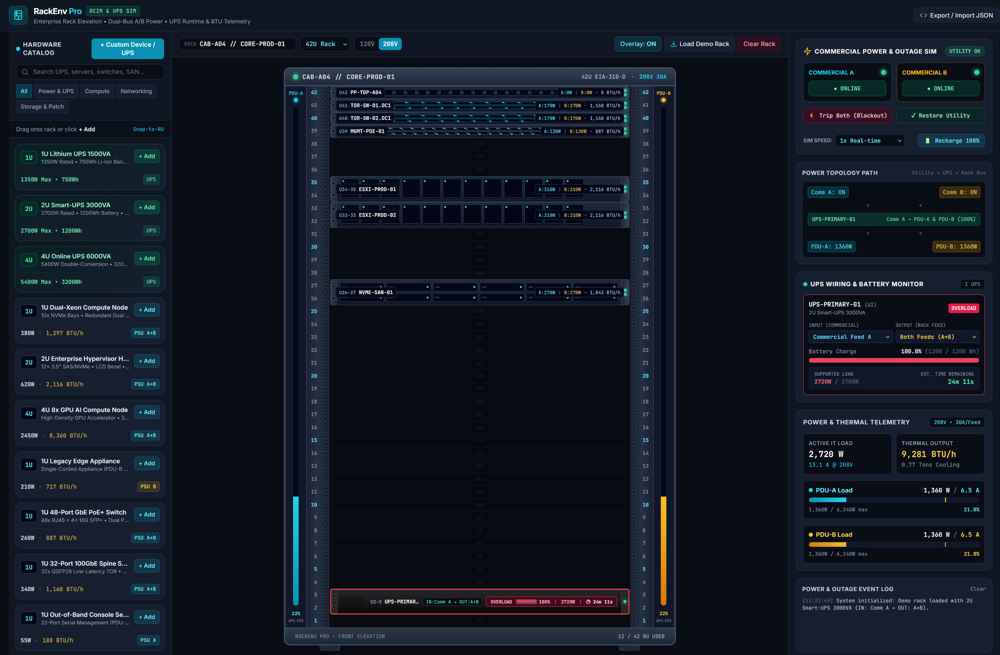

# RackEnv Pro

**Enterprise Server Rack Elevation, Dual-Bus A/B Power & UPS Runtime Simulator**

RackEnv Pro is a zero-dependency, browser-based Data Center Infrastructure Management (DCIM) planning and power-simulation application. It enables infrastructure engineers, solutions architects, and lab operators to design EIA-310-D server rack elevations, configure upstream and downstream Uninterruptible Power Supply (UPS) wiring, simulate commercial utility outages, and monitor live power, thermal (`BTU/hr`), and battery runtime telemetry.


---

## Table of Contents

- [Key Features](#key-features)
- [Engineering & Simulation Formulas](#engineering--simulation-formulas)
- [Getting Started](#getting-started)
- [Interactive Workflows](#interactive-workflows)
- [JSON Configuration Format](#json-configuration-format)
- [Technology Stack](#technology-stack)

---

## Key Features

### 1. Snap-to-RU Rack Elevation & Hardware Graphics
- **Multi-Size Steel Cabinets**: Switch seamlessly between **42U**, **48U**, and **24U** EIA-310-D rack enclosures with left and right cage-nut mounting rails and prominent Rack Unit (`RU`) numbering.
- **Drag-and-Drop & Touch Placement**: Drag hardware from the catalog or reposition installed gear directly within the rack with real-time green/red Snap-to-RU collision detection.
- **Procedural Chassis Faceplates**: Detailed front elevations for 1U/2U compute servers, 4U 8x GPU AI nodes, 48-port PoE+ and 32-port 100GbE switches, NVMe/SAS SAN arrays, passive patch panels, and rackmount UPS units—complete with live PSU-A/B status LEDs and toggleable telemetry overlays.
- **Flanking Zero-U PDUs**: Dedicated left (`PDU-A`, cyan) and right (`PDU-B`, amber) vertical Power Distribution Unit strips displaying real-time utilization bars and feed source badges (`COMM A/B` vs. `UPS-FED`).

### 2. Custom Hardware & UPS Catalog Builder
- **Built-In Enterprise Catalog**: Search and filter across *Power & UPS*, *Compute Servers*, *Networking*, and *Storage & Patch*.
- **+ Custom Device / UPS Creator**: Define custom IT devices (name, RU height, power draw in Watts, single/dual PSU mode, and chassis appearance) or custom battery UPS systems (name, RU height, rated output capacity in Watts, battery bank energy in `Wh`, and default input/output wiring).

### 3. Dual-Bus A/B Power & UPS Wiring Topology
- **Flexible UPS Wiring**:
  - **UPS Input**: Wire each UPS upstream to **Commercial Feed A** or **Commercial Feed B**.
  - **UPS Output**: Route protected UPS output to **Feed A Only (`PDU-A`)**, **Feed B Only (`PDU-B`)**, or **Both Feeds (`PDU-A + PDU-B`)**.
- **Automatic PSU Failover**: Dual-corded (`A+B`) IT hardware splits load `50% / 50%` across both PDUs during normal operation and automatically transfers `100%` of its draw onto the surviving feed if one bus loses power. Single-corded (`A Only` or `B Only`) equipment powers down immediately when its assigned bus drops.
- **Voltage & Circuit Capacity Modeling**: Toggle between **208V** (`30A` breaker = $6{,}240\text{ W}$ max per PDU) and **120V** (`20A` breaker = $2{,}400\text{ W}$ max per PDU), with visual `80%` NEC continuous load markers and overload warnings above `100%`.

### 4. Commercial Outage & UPS Battery Drain Simulator
- **Interactive Breaker Controls**: Independently trip or restore **Commercial A** and **Commercial B**, or trigger instant **Trip Both (Blackout)** and **Restore Utility** scenarios.
- **Dynamic Battery Discharge & Countdown**: When a UPS loses its upstream commercial feed, it transitions to `ON BATTERY` mode, draining energy (`Wh`) in real time proportional to its connected IT load and displaying a live **Estimated Time Remaining** countdown.
- **Simulation Time Scaling & Recharge**: Accelerate simulation time (`1x`, `10x`, `60x`, or `300x`) to test multi-hour battery runtimes in seconds, observe automatic battery recharging upon utility restoration, or click **Recharge 100%** to reset battery banks.
- **Live Topology & Event Log**: Inspect the end-to-end `Commercial Utility -> UPS -> Rack PDU` flow diagram alongside a timestamped **Power & Outage Event Log**.

---

## Engineering & Simulation Formulas

RackEnv Pro calculates electrical current, thermal dissipation, and UPS battery runtime using standard data center engineering equations:

- **Circuit Current ($I$)**:
  $$I = \frac{P}{V}$$
  where $P$ is active power in Watts ($\text{W}$) and $V$ is nominal AC voltage ($120\text{ V}$ or $208\text{ V}$).

- **Heat Dissipation ($\text{BTU/hr}$) & Cooling Load ($\text{Tons}$)**:
  $$\text{BTU/hr} = P \times 3.41214$$
  $$\text{Tons of Cooling} = \frac{\text{BTU/hr}}{12{,}000}$$

- **UPS Battery Drain Rate ($P_{\text{battery}}$)**:
  Accounts for supported IT output load ($P_{\text{load}}$), inverter conversion efficiency ($\eta = 0.92$), and baseline inverter tare loss ($P_{\text{tare}} = 20\text{ W}$):
  $$P_{\text{battery}} = \frac{P_{\text{load}}}{\eta} + P_{\text{tare}}$$

- **Estimated Runtime Remaining ($t_{\text{rem}}$ in hours)**:
  $$t_{\text{rem}} = \frac{E_{\text{rated}} \times \left(\frac{\text{SoC}}{100}\right)}{P_{\text{battery}}}$$
  where $E_{\text{rated}}$ is the battery capacity in Watt-hours ($\text{Wh}$) and $\text{SoC}$ is the current State of Charge ($0\%$ to $100\%$).

---

## Getting Started

RackEnv Pro is packaged as a single self-contained HTML file (`index.html`) with no build steps or server dependencies required.

1. Download or clone `index.html` to your local machine.
2. Open `index.html` directly in any modern web browser (Chrome, Edge, Firefox, or Safari).
3. An active internet connection is only needed on initial load to fetch Tailwind CSS and Google Fonts (`Inter` and `JetBrains Mono`).

---

## Interactive Workflows

1. **Populate the Rack**:
   - Drag equipment from the **Hardware Catalog** on the left onto the center cabinet, or click **+ Add** to auto-place hardware into the lowest available RU slot.
   - Click **Load Demo Rack** in the top toolbar at any time to restore a pre-configured `42U` production rack complete with switches, hypervisors, an NVMe SAN, and a `2U Smart-UPS 3000VA`.
2. **Configure UPS Input & Output Wiring**:
   - When placing a UPS—or by clicking any installed UPS in the rack or right-hand **UPS Wiring & Battery Monitor**—select whether its **Input** draws from `Commercial Feed A` or `Commercial Feed B`, and whether its **Output** energizes `Feed A Only`, `Feed B Only`, or `Both Feeds (A+B)`.
3. **Simulate a Utility Outage**:
   - In the **Commercial Power & Outage Sim** panel, click **● ONLINE** on **Commercial A** or **Commercial B** to trip that feed.
   - Watch dual-corded devices fail over to the live bus, or watch any UPS fed by the tripped commercial feed switch to `ON BATTERY` and begin draining according to its supported load.
   - Increase **Sim Speed** to `60x` or `300x` to observe full battery depletion and downstream PDU loss.
4. **Save & Share Configurations**:
   - Click **Export / Import JSON** in the header to copy your rack layout and UPS wiring state as portable JSON, or paste an existing JSON payload to restore a saved design.

---

## JSON Configuration Format

```json
{
  "app": "RackEnv Pro",
  "rackName": "CAB-A04 // CORE-PROD-01",
  "rackHeight": 42,
  "voltage": 208,
  "installedDevices": [
    {
      "instanceId": "demo-ups-1",
      "templateId": "ups-2u-3000",
      "isUps": true,
      "name": "2U Smart-UPS 3000VA",
      "label": "UPS-PRIMARY-01",
      "uHeight": 2,
      "startU": 2,
      "ratedWatts": 2700,
      "batteryCapacityWh": 1200,
      "chargePct": 100,
      "upsInput": "A",
      "upsOutput": "AB",
      "style": "ups"
    },
    {
      "instanceId": "demo-srv-1",
      "templateId": "srv-2u-virt",
      "isUps": false,
      "name": "2U Enterprise Hypervisor Host",
      "label": "ESXI-PROD-01",
      "uHeight": 2,
      "startU": 34,
      "watts": 620,
      "feedMode": "AB",
      "style": "server-2u"
    }
  ]
}
```

---

## Technology Stack

- **HTML5 & Vanilla JavaScript (ES6+)**: Real-time `250ms` simulation tick engine, HTML5 Drag-and-Drop API, and mobile touch-drag gesture handling.
- **Tailwind CSS**: Utility-first dark-mode DCIM interface styling.
- **Typography**: `Inter` for UI controls and `JetBrains Mono` (`tabular-nums`) for live electrical and thermal readouts.
